#    Marknote

Write down your thoughts.

> [!NOTE]
> **This is a personal fork** of [KDE's Marknote](https://invent.kde.org/office/marknote)
> with a Dolphin-style interface overhaul. It is not affiliated with or submitted to KDE.
> The "[About this fork](#about-this-fork)" section describes fork-only changes; the rest of
> this README is upstream's.

## About this fork

Built on current KDE `master` (which includes the GSoC 2026 block editor), plus
[Mermaid diagram rendering (KDE MR !299)](https://invent.kde.org/office/marknote/-/merge_requests/299).

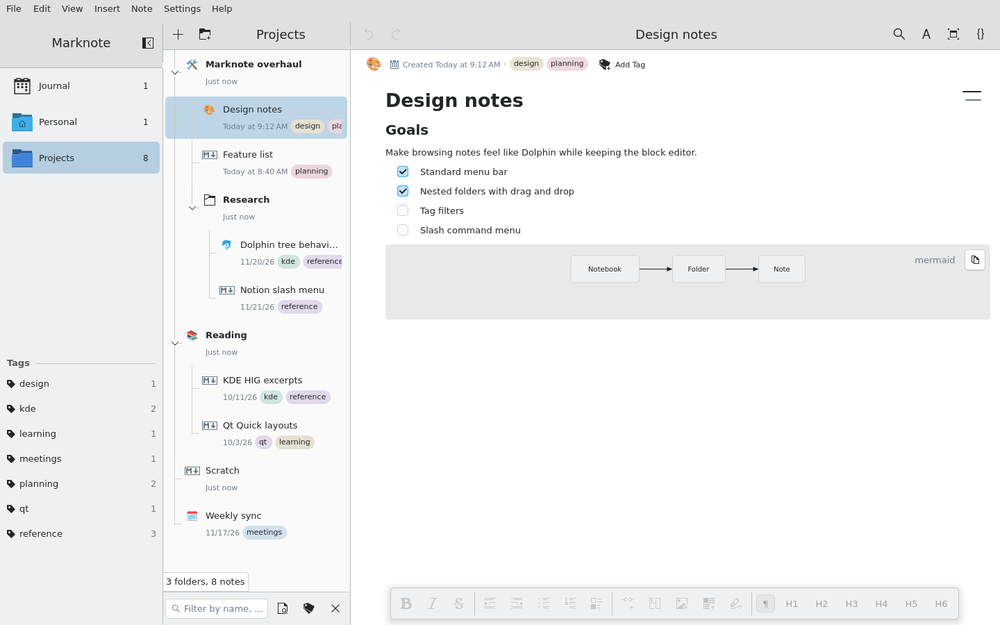

### Changes in this fork

**Window and navigation**
- Standard in-window KDE **menu bar** (File, Edit, View, Insert, Note, Settings, Help),
  toggled with *Settings › Show Menubar* (<kbd>Ctrl</kbd>+<kbd>M</kbd>).
- Right-click on the **notebooks sidebar** for *New Notebook…*, import, and sidebar options.
- The sidebar lists the current notebook's **tags** with note counts; click one to filter.

**Folder tree (Dolphin-style)**
- Nested folders with a **folder context menu**: *New Note Here*, *New Subfolder*,
  *Rename* (also <kbd>F2</kbd>, in place), *Set Icon*, *Expand/Collapse*, *Delete*.
- **Drag and drop**: onto a folder to move a note in, onto a note to move next to it,
  onto empty space to move it to the top of the notebook.
- Each row shows the note's **icon or emoji**, its **tags** and its **created date**
  (visible by default; *View › Show Tags / Show Created Date*).
- *View › Density*: **Compact** (one line, tag dots and a short date), **Normal** (title, then
  date and tags on a tight second line) or **Comfortable** rows. Dates and tags show in all three.
- *View › Sort Notes › By Created Date*.

**Filter bar**
- Always visible under the notes list (<kbd>Ctrl</kbd>+<kbd>E</kbd> to focus).
- Filters by name, `tag:name`, or — with **Contents** on — the text inside notes.
- Selected tags show as chips, with an **All tags / Any tag** switch.

**Notes**
- **Icon or emoji** for any note or folder (emoji search, theme icons, full KDE icon browser).
- **Tags** on any note, with an autocompleting tag editor (<kbd>Ctrl</kbd>+<kbd>Shift</kbd>+<kbd>T</kbd>).
- A separate strip above the editor shows the note's icon, created date and tags.
- **Zoom** notes with <kbd>Ctrl</kbd>+mouse wheel, <kbd>Ctrl</kbd>+<kbd>+</kbd>/<kbd>−</kbd>
  (reset with <kbd>Ctrl</kbd>+<kbd>0</kbd>) or *View › Zoom*; the level is remembered.
- **Slash menu** (type `/`) grouped into Text / Lists / Blocks, showing each block's
  Markdown shortcut; the *Insert* menu inserts the same blocks.

**Storage**
- **Image links are relative to the note**, so a notebook folder can be copied, synced or
  moved anywhere. Inserted images and sketches are linked relatively; images from outside
  the notebook are first copied next to the note (`<Note>_<timestamp>.png`). Moving a note
  or folder fixes its links and takes the note's own images along. Older notes with
  absolute `file://` links still show; right-click a notebook › *Make Image Links Relative*
  converts them. Exports resolve relative images too.
- Note metadata lives in Obsidian-compatible YAML front matter (`id`, `created`, `icon`,
  `tags`); the editor never shows it and keeps it intact on save. Plain notes get one the
  first time they are edited. Folder icons go in Dolphin's `.directory` file.

**Sync**
- Each notebook syncs on its own, to **Google Drive** or to **another folder** (for example
  one Nextcloud or Syncthing already syncs): right-click a notebook › *Sync Settings…*, then
  *Sync Now* (<kbd>Ctrl</kbd>+<kbd>Alt</kbd>+<kbd>S</kbd>, also in the *File* menu).
- Changes go both ways. When a note was edited on two devices, both versions are kept
  (`Note (conflict 2026-11-24 0915).md`). Deleted notes are moved to a trash folder
  (`.marknote/trash`, or the Drive trash), never destroyed. An open note reloads when sync
  brings in a newer version.
- Google Drive access uses the `drive.file` scope: Marknote can only see files it created.
  The sign-in is kept in KDE Wallet. No OAuth client is shipped; see below.

<table>
<tr>
<td>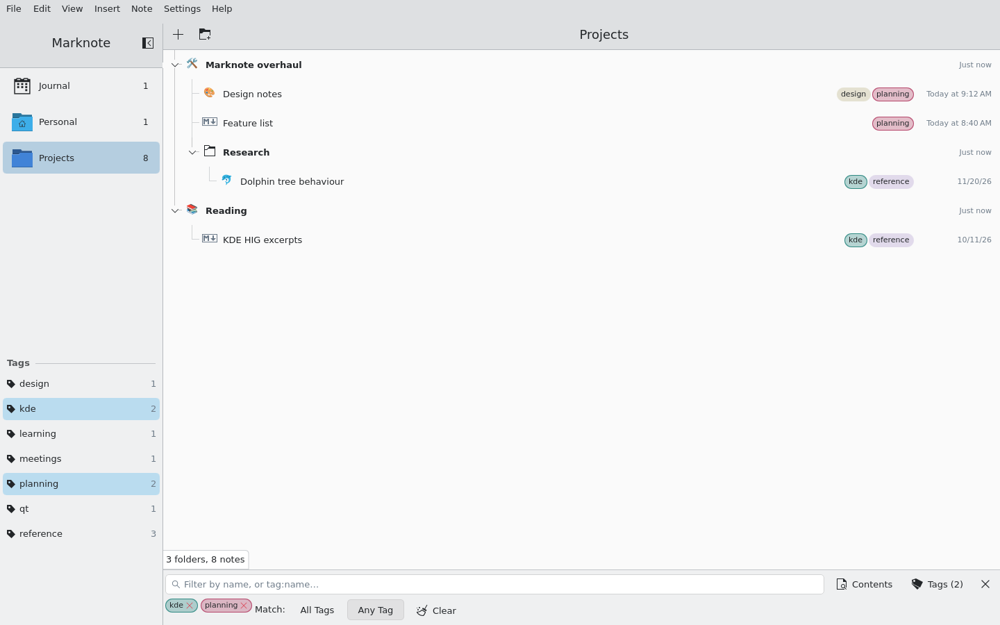<br><sub>Tag filter, <i>Any tag</i> mode</sub></td>
<td>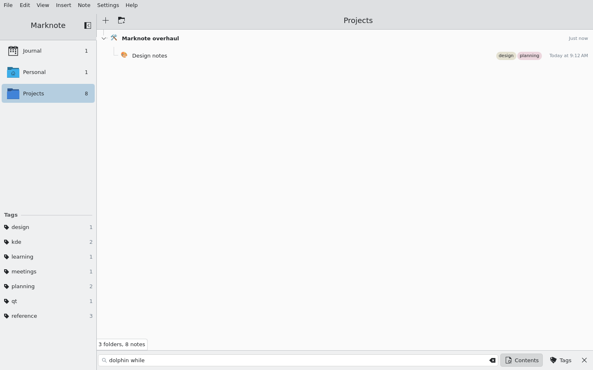<br><sub>Searching inside notes (<i>Contents</i>)</sub></td>
</tr>
<tr>
<td>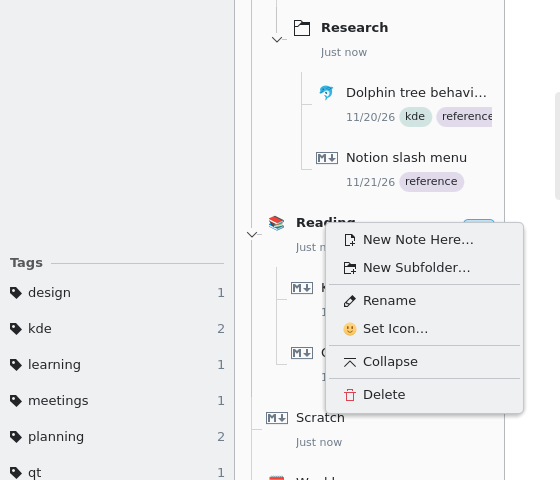<br><sub>Folder context menu</sub></td>
<td>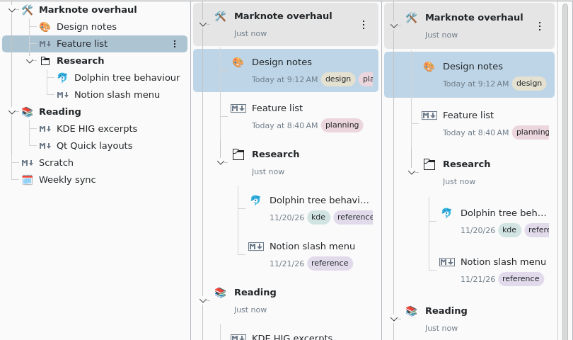<br><sub>Density: compact, normal, comfortable</sub></td>
</tr>
<tr>
<td>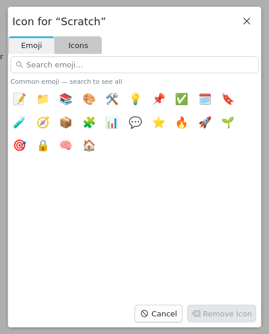 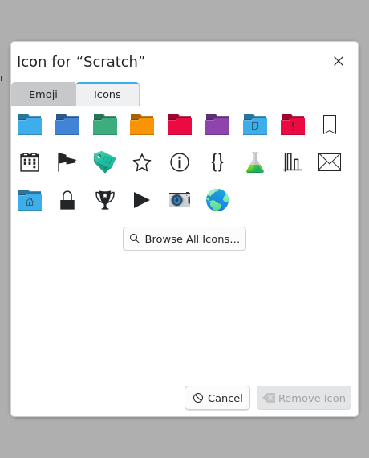<br><sub>Icon or emoji for notes and folders</sub></td>
<td>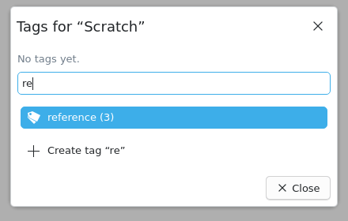<br><sub>Tag editor</sub></td>
</tr>
<tr>
<td>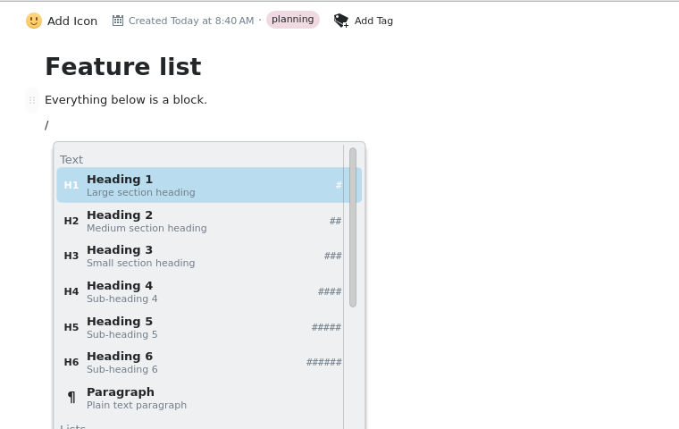<br><sub>Slash menu</sub></td>
<td>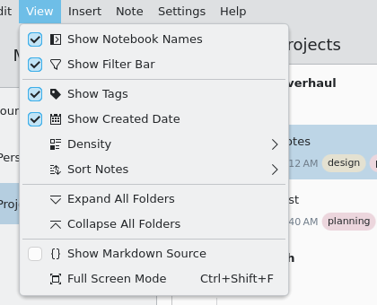 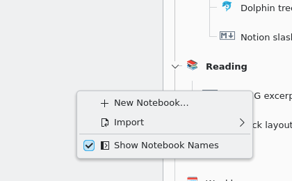<br><sub>View menu and notebooks sidebar menu</sub></td>
</tr>
<tr>
<td>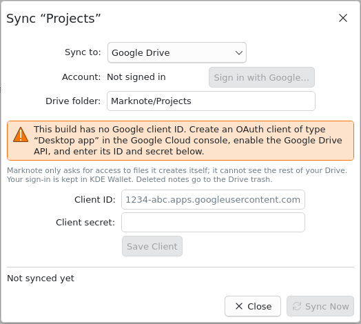<br><sub>Per-notebook sync settings</sub></td>
<td>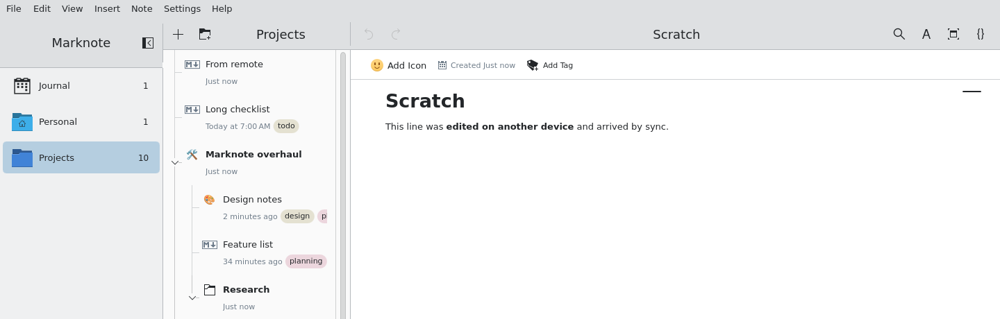<br><sub>An open note updated by sync</sub></td>
</tr>
</table>

**Web app for phones** (folder [`web/`](web/README.md))
- An installable web app (PWA) for Android and iPhone that opens the same notebooks from
  Google Drive: tree with drag and drop, tags, filter, icons, notes with math, Mermaid
  diagrams and images, a live-preview Markdown editor with a `/` menu, photo upload,
  an offline copy with edits uploaded later, and conflict copies instead of overwrites. Try it with `?demo`; setup is in [web/README.md](web/README.md).

**Encrypted notebooks** (format: [docs/encryption.md](docs/encryption.md))
- Right-click a notebook › *Encrypt Notebook…*: every note's text, tags, icon and dates
  are encrypted with a password (Argon2id + XChaCha20-Poly1305, libsodium). Note titles
  (file names), folder names and images stay readable, and the app says so.
- You get a **recovery key** once. Store it in your password manager: without the
  password or that key, nobody can read the notes, not even you.
- Locked notebooks list their notes by title; opening one asks for the password.
  Lock now with Ctrl+Shift+L; auto-lock after 5–60 idle minutes (Settings menu).
  Change the password or remove encryption from the notebook menu.
- Synced notebooks stay encrypted on Google Drive; the web app unlocks and edits them
  too (encrypting a notebook or changing its password is desktop-only for now).

**Seeing what sync changed**
- Synced notebooks check for changes in the background (at start, every 5 minutes, and
  when you come back to the window; *Settings › Sync in the Background*).
- Notes that arrived from another device are marked with a dot (folders and notebooks
  show how many) until you open them, like unread mail.
- Opening such a note says where and when it changed. If both sides changed it, the
  banner explains that both versions were kept and opens the other one.
- The cloud button next to *New Folder* shows the sync state ("Synced with Google Drive
  3 min ago", or the error) and the recent changes, each one clickable.

### Setting up Google Drive sync

Google requires every app that signs in to have an OAuth client. This repository and
its CI builds contain none: you create your own (free, once) and enter it on each device.
It is stored only in that device's settings (`~/.config/marknoterc`), never in a notebook
folder.

1. In the [Google Cloud console](https://console.cloud.google.com/), create a project and
   enable the **Google Drive API** (*APIs & Services › Library*).
2. *APIs & Services › OAuth consent screen*: user type **External**, fill in the app name
   and your e-mail. Add the scope `https://www.googleapis.com/auth/drive.file` (the full URL; the console
   lists it as `…/auth/drive.file`). Then set the publishing status to
   **In production**: while it is in *Testing*, Google expires the sign-in after 7 days.
   (`drive.file` is a non-sensitive scope, so no Google review is needed; the consent page
   says the app is unverified until you verify it.)
3. *Credentials › Create credentials › OAuth client ID*, type **Desktop app**. Copy the
   client ID and secret.
4. Paste them into Marknote (*Sync Settings…* › *Google Drive* › *Use my own Google OAuth
   client*).

Then choose *Sign in with Google…*. The browser opens Google's consent page and returns
to Marknote on its own (it listens on `127.0.0.1` for the reply).

### Installing this fork

Builds come from GitHub Actions (*Actions › Build Flatpak* › a successful run › **Artifacts**).
Download `marknote-flatpak`, unzip it, then:

```sh
flatpak install --user flathub org.kde.Platform//6.11
flatpak install --user --reinstall marknote.flatpak
flatpak run org.kde.marknote
```

Back up your notes folder first (default `~/Documents/Notes`): editing a note adds the
front matter described above.

Planned work (math rendering, encryption, Google Cloud Storage, Android) is tracked in [TODO.md](TODO.md).

---

Marknote supports a wide range of formatting options useful for taking everyday notes, like bold, italic, underlined and strike through fonts as well as headings, lists, check boxes, images and more.

 

## Installation

<a href='https://flathub.org/apps/details/org.kde.marknote'></a>

<a href='https://snapcraft.io/marknote'></a>


Nightly flatpak: [https://cdn.kde.org/flatpak/marknote-nightly/org.kde.marknote.flatpakref](https://cdn.kde.org/flatpak/marknote-nightly/org.kde.marknote.flatpakref)


## Contributing and AI
Contributors keep this project alive! We greatly appreciate any help. To make it possible for us to review your contributions properly, please respect the following guidelines:

### Merge Requests

Code contributions should be submitted through merge requests. Please clearly explain what your merge request does.

### Bug Reports

Bug reports can be submitted either on bugs.kde.org or through the work items of this repository.

### Feature Requests and Discussion

If you have great ideas, come talk to us! You can do so either through the work items or by joining our Matrix room: [#marknote:kde.org](https://matrix.to/#/#marknote:kde.org).

### AI

The use of "AI" for contributions is strongly discouraged. If you nevertheless choose to use "AI", please never submit code that you do not fully understand. If "AI" has been involved in your merge request or bug report, you must add the #AI-generated label.

Most "AI"-generated submissions we have received so far have been nonsensical or unnecessarily complicated. We therefore take extra precautions when reviewing "AI"-generated submissions.

## Build Instructions

### flatpak builder (with kde sdk)
```
flatpak-builder tmp --force-clean --ccache --install --user org.kde.marknote.json
```
### cmake
```
mkdir build
cd build
cmake ..
make
```
### kdesrc-build
```
kdesrc-build marknote
```

### Nix
#### Dev path:
```
nix develop
cmake -B build -G Ninja -DCMAKE_BUILD_TYPE=Debug
cmake --build build
./build/bin/marknote
```
#### Package path:
```
nix build .#marknote
./result/bin/Marknote
```

