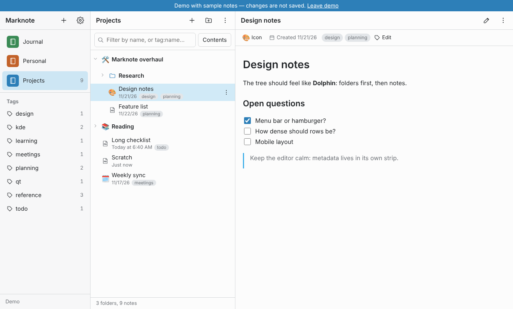
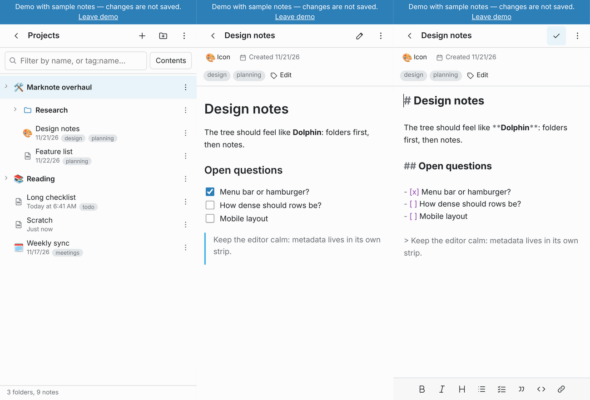
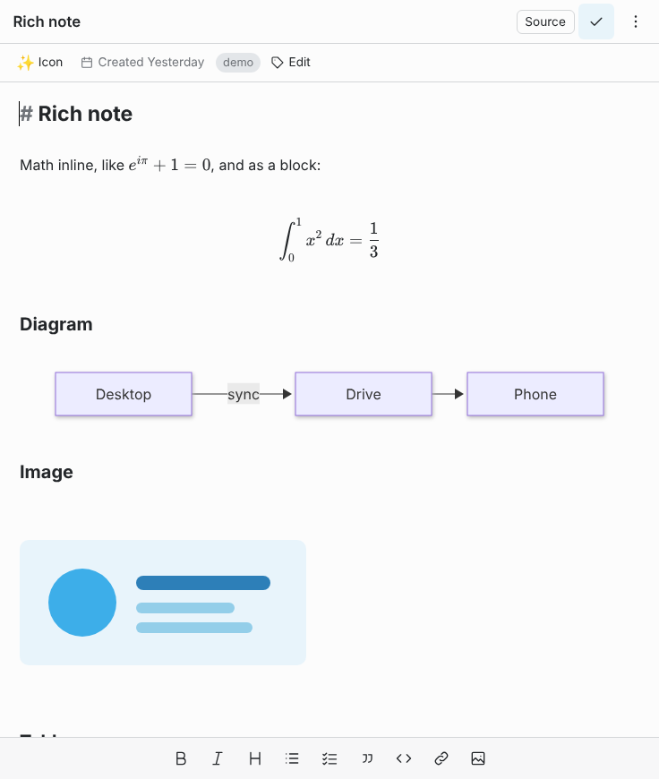
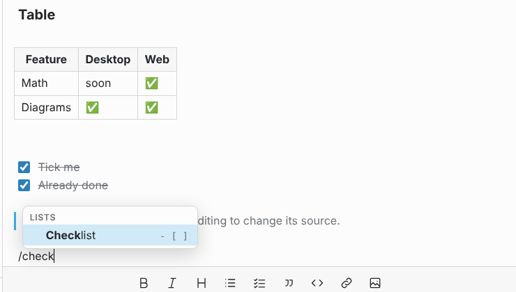
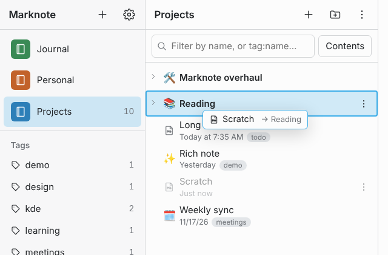

# Marknote web

Your Marknote notebooks from Google Drive, in the browser. It installs like an app
on Android and iPhone (a PWA) and keeps working offline.

It reads and writes the same files as Marknote desktop's Google Drive sync: one Drive
folder per notebook (by default `Marknote/<notebook>`), notes as Markdown with YAML
front matter (`id`, `created`, `icon`, `tags`), folder icons in `.directory` files.

**Try it without an account:** open the app with `?demo` (sample notes in memory,
nothing is saved).




  

## What it does

- Notebooks, folder tree (expand/collapse), note icons/emoji and tags, created dates.
- Filter by name or `tag:name`, tag chips with *All tags* / *Any tag*, *Contents* to
  search inside notes, tag list with counts.
- Read notes rendered, with **math** (`$…$`, `$$…$$`, KaTeX), **Mermaid diagrams**,
  **images**, tables and code; tick checklist items directly.
- **Live preview editor:** formatting shows as you write and the Markdown syntax
  appears only on the line you are editing. Checkboxes tick, and images, math,
  diagrams and tables are rendered; tap one to edit its source. The text is kept
  exactly as written, so desktop and web never reformat each other's notes.
  *Source* shows the plain Markdown. Edits save automatically; the front matter is
  never shown and is kept.
- **`/` menu** at the start of a line inserts blocks (headings, lists, checklist,
  quote, code, table, divider, math, diagram, image), like the desktop slash menu.
  A formatting bar (bold, italic, heading, list, checklist, quote, code, link,
  image) sits at the bottom.
- **Images:** add from a file or the phone camera, or paste/drop them into the
  editor. They are stored next to the note as `<Note>_<timestamp>.<ext>` (the
  desktop's sketch naming) and linked relatively. Desktop links of the form
  `file:///…/Notes/<Notebook>/…` are found in the notebook too. Images you viewed are
  kept for offline use.
- **Drag and drop** in the tree, as on the desktop: onto a folder moves into it, onto
  a note moves next to it, onto empty space moves to the top level. With touch, hold
  a note, then drag (hold and release opens its menu).
- New note / folder, rename, move, delete (to the Drive trash), set icon, edit tags,
  new notebook.
- **Never overwrites another device's edit.** A note is only saved over the version
  it was opened from. If it changed elsewhere meanwhile (say, on the desktop), your
  edit is saved next to it as `Name (conflict 2026-11-24 0915).md`, like desktop sync.
- **Offline:** notebooks and notes you have opened stay on the device. Edits and new
  notes made offline (or after the Google sign-in expired) wait on the device and
  upload when you are back. Rename/move/delete and new folders need a connection.
- Light/dark theme, text size, sorting.

## Privacy: your OAuth client stays private

This repository is public, so it contains **no** Google OAuth client and the published
site contains none either (CI checks both). You enter your client ID on each device:

- in the app's first screen, or
- by opening a **setup link** (`…/marknote/#setup=<client id>`, shown in Settings). The
  part after `#` is never sent to the web server; the app stores it in the browser and
  removes it from the address bar.

The client ID is kept in that browser's `localStorage`; sign-in tokens only in
`sessionStorage` (they expire within an hour). A web client needs no client secret.
Even if someone learns the client ID, Google only accepts it from the origins you list
in step 3 below.

## Set up Google sign-in (once)

Use **the same Google Cloud project as Marknote desktop.** With the `drive.file`
scope, an app only sees files created by that same project, so a client in a
different project would see an empty Drive.

1. [Google Cloud console](https://console.cloud.google.com/) › your Marknote project.
   (No project yet: create one, enable the **Google Drive API**, and set up the
   **OAuth consent screen** as described in the main README: External, scope
   `https://www.googleapis.com/auth/drive.file` (full URL), publishing status **In production**.)
2. *APIs & Services › Credentials › Create credentials › OAuth client ID* ›
   **Web application**.
3. Add where the app runs (exact values; the app's first screen shows them too):
   - **Authorized JavaScript origins:** `https://nesanders.github.io`
   - **Authorized redirect URIs:** `https://nesanders.github.io/marknote/`
   For local testing also add `http://localhost:8080` and `http://localhost:8080/`.
4. Copy the **client ID** (not the secret) and paste it into the app, or open
   `https://nesanders.github.io/marknote/#setup=<client id>` on the device.
5. *Sign in with Google*.

Sign-in uses Google's flow for browser apps: the page goes to Google and comes back
with an access token valid for about an hour. When it expires the app renews it
quietly if you are still signed in to Google in that browser; otherwise it asks you to
sign in again. Your edits are kept on the device meanwhile.

## Install on a phone

- **Android (Chrome):** open the site › menu ⋮ › *Install app* (or *Add to Home screen*).
- **iPhone/iPad (Safari):** Share › *Add to Home Screen*.

On iPhone, Safari may delete the offline copy of a home-screen web app that has not
been opened for a few weeks. Your notes are safe in Drive; just open it online once.

## Develop

```sh
cd web
npm ci
npm test                      # unit tests (front matter, notebooks, conflicts, offline)
node build.mjs --serve        # http://localhost:8080/  (and /?demo)
node test/e2e.cjs [shots/]    # browser test; needs Playwright with Chromium
```

The site is plain static files built with esbuild (Preact, CodeMirror 6,
markdown-it, DOMPurify) and deployed to GitHub Pages by
`.github/workflows/web-pages.yml`.

## Limits

- No WYSIWYG block editor like the desktop app: the web app edits Markdown with a
  live preview instead (this keeps notes byte-for-byte as written).
- Adding images, moving, renaming and deleting need a connection; text edits and new
  notes work offline.
- Math and diagram libraries load the first time a note uses them (cached afterwards).
